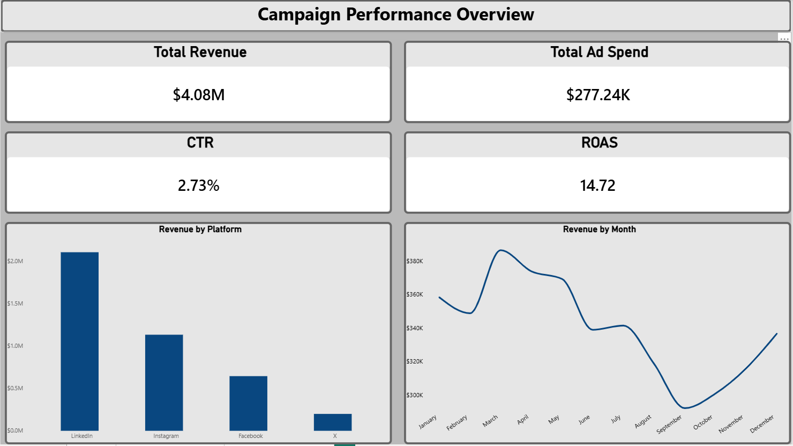
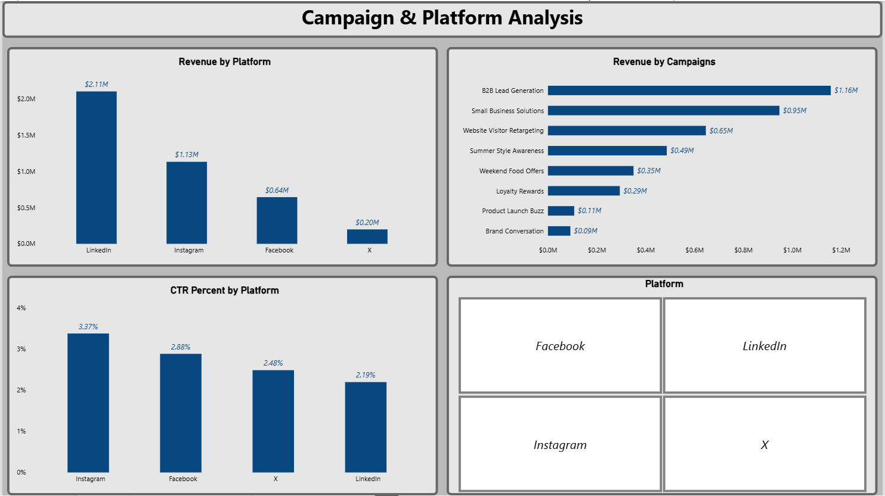
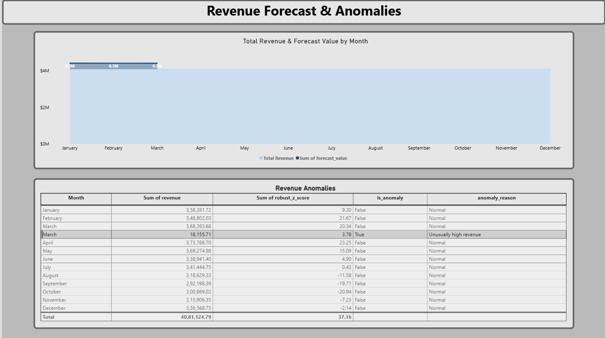
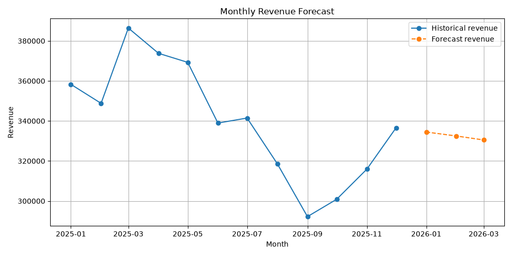
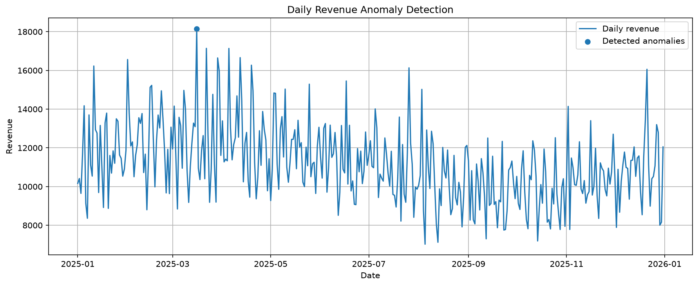

# 📱 Social Media Campaign Analytics


## 📋 Business Problem

Businesses invest in social media advertising across platforms such as Instagram, LinkedIn, Facebook, and X. However, comparing campaign effectiveness, advertising expenditure, revenue generation, and conversion performance can be challenging without a centralized analytics solution.

Marketing teams need data-driven insights to identify high-performing campaigns, evaluate platform effectiveness, forecast future revenue, and detect unusual revenue patterns.

## 🎯 Objective

Build an end-to-end analytics solution using MySQL, Python, and Power BI to:

- Analyze campaign revenue and advertising expenditure.
- Compare performance across social media platforms.
- Calculate CTR, ROAS, and conversion rate.
- Identify the highest-performing campaigns.
- Forecast revenue for the next three months.
- Detect unusual daily revenue patterns using statistical techniques.
- Present actionable insights through interactive dashboards.

## 📊 Key Findings

| Finding | Insight |
|---------|---------|
| 📈 Highest CTR | Instagram — 3.37% |
| 💼 LinkedIn CTR | 2.19% |
| 🏆 Highest ROAS | Small Business Solutions — LinkedIn, 24.22 |
| 🎯 Highest Conversion Rate | B2B Lead Generation — 5.99% |
| 🚨 Anomaly Detection | 1 anomaly identified across 365 daily observations |
| 📅 Revenue Trend | Monthly revenue changes fluctuated, approximately between -2% and +6% |

*These findings are based on the synthetic dataset generated for this project. ROAS and conversion rate reflect the calculations used in the analysis.*

## 🛠️ Tools & Techniques

| Tool | Usage | Techniques |
|------|-------|------------|
| Python | Data generation and analysis | Pandas, NumPy, Matplotlib, functions, data processing |
| MySQL | Data storage and analysis | Joins, aggregations, GROUP BY, KPI calculations, monthly revenue analysis |
| Statsmodels | Revenue forecasting | Exponential Smoothing, additive trend |
| Python | Anomaly detection | Median Absolute Deviation (MAD), robust Z-score |
| Power BI | Interactive dashboard | DAX measures, KPI cards, charts, slicers, filters |
| MySQL Connector/Python | Database integration | Python-to-MySQL data loading and result storage |

## 📁 Project Structure

```text
social-media-campaign-analytics/
│
├── data/
│   ├── raw/
│   │   ├── campaigns.csv
│   │   └── campaign_performance.csv
│   └── processed/
│
├── python/
│   ├── environment_check.py
│   ├── generate_dataset.py
│   ├── load_to_mysql.py
│   ├── forecast_revenue.py
│   ├── detect_anomalies.py
│   └── save_results_to_mysql.py
│
├── sql/
│   └── analysis.sql
│
├── powerbi/
│   └── social_media_campaign_analytics.pbix
│
├── insights/
│   ├── daily_revenue_anomalies.png
│   ├── daily_revenue_anomaly_results.csv
│   ├── [forecast chart files]
│   ├── PowerBI_page1.png
│   ├── PowerBI_page2.png
│   └── PowerBI_page3.png
│
└── README.md
```

*Update the structure and filenames to match the actual files in your GitHub repository.*

## 📸 Dashboard Screenshots

### Power BI — Campaign Performance Overview



### Power BI — Campaign & Platform Analysis



### Power BI — Revenue Forecast & Anomalies



## 🐍 Python Analysis & Revenue Trends

### 📈 Revenue Forecasting — Exponential Smoothing

Used Python and Statsmodels to forecast revenue for the next three months using an Exponential Smoothing model with an additive trend.



**Techniques used:**
- Time-series data preparation
- Exponential Smoothing with additive trend
- Three-month revenue forecasting
- Forecast visualization using Matplotlib

### 🚨 Daily Revenue Anomaly Detection

Applied a robust Z-score method based on the median and Median Absolute Deviation (MAD) to identify unusual daily revenue patterns.



**Techniques used:**
- Median and MAD calculations
- Robust Z-score analysis
- Anomaly threshold: absolute robust Z-score greater than 3.5
- Identification and storage of anomaly results in MySQL

**Result:** One anomaly was identified across 365 daily revenue observations.

### 🔄 Python-to-MySQL Integration

Python was used to store forecasting and anomaly detection outputs in MySQL tables for further reporting in Power BI.

| Python Script | Purpose |
|---|---|
| `generate_dataset.py` | Generates synthetic campaign datasets |
| `load_to_mysql.py` | Loads campaign data into MySQL |
| `forecast_revenue.py` | Forecasts future revenue |
| `detect_anomalies.py` | Detects unusual revenue observations |
| `save_results_to_mysql.py` | Saves forecast and anomaly results to MySQL |

*Note: Update the image paths above to match the actual filenames in your `insights/` folder. The forecast image filename is an example; use the real filename generated by your script.*

## 🔍 Analysis Performed

### 1. MySQL Analysis

- Aggregated revenue and advertising spend.
- Compared CTR across social media platforms.
- Ranked campaigns based on ROAS.
- Evaluated campaign conversion rates.
- Analyzed monthly revenue and month-over-month changes.
- Stored forecast and anomaly detection outputs in MySQL tables.

### 2. Python Revenue Forecasting

- Used Statsmodels Exponential Smoothing.
- Applied an additive trend without a seasonal component.
- Generated revenue forecasts for the next three months.
- Saved forecast results and visualization outputs.
- Stored forecast records in MySQL for Power BI reporting.

### 3. Python Anomaly Detection

- Analyzed daily revenue observations.
- Calculated robust Z-scores using the median and median absolute deviation.
- Applied an absolute robust Z-score threshold greater than 3.5.
- Identified unusual revenue observations for further investigation.
- Stored anomaly results in MySQL.

### 4. Power BI Dashboard

Developed three interactive report pages:

- **Page 1:** Campaign Performance Overview — revenue, advertising spend, CTR, and ROAS.
- **Page 2:** Campaign & Platform Analysis — revenue by platform, campaign rankings, CTR comparison, and platform filtering.
- **Page 3:** Revenue Forecast & Anomalies — forecasted revenue and detected daily revenue anomalies.

## 💡 Business Recommendations

1. **Investigate Instagram engagement:** Examine the campaign types, audiences, and creatives associated with its higher CTR.
2. **Review high-ROAS campaigns:** Analyze the Small Business Solutions campaign to understand its revenue and advertising-spend assumptions.
3. **Optimize conversion performance:** Investigate the B2B Lead Generation campaign's targeting and conversion funnel.
4. **Monitor revenue anomalies:** Investigate unusual daily revenue observations before making budget decisions.
5. **Use forecasts for planning:** Compare forecast values against actual results as new data becomes available.
6. **Evaluate multiple KPIs:** Consider revenue, spend, CTR, conversion rate, and ROAS together when allocating advertising budgets.

## 🎯 Project Outcomes

- Built an end-to-end analytics workflow connecting Python, MySQL, and Power BI.
- Processed 2,920 daily campaign performance records across eight campaigns.
- Developed campaign and platform performance KPIs.
- Generated three-month revenue forecasts.
- Detected one anomaly across 365 daily revenue observations.
- Created a three-page Power BI dashboard for campaign analysis and reporting.

## 👨‍💻 Analyst

**Ovean S** | Aspiring Data Analyst

📧 ovean14272000@gmail.com

🔗 [LinkedIn](https://www.linkedin.com/in/ovean-sugirdas)

🐙 [GitHub](https://github.com/ovean1414)

## 📌 Dataset Note

The dataset was synthetically generated using Python to simulate daily social media campaign performance across four platforms. Campaign names, impressions, clicks, conversions, advertising spend, and revenue are generated for educational and portfolio demonstration purposes.

The results do not represent actual business performance or verified advertising benchmarks. Revenue forecasts are exploratory estimates, and detected anomalies require further investigation.

This project demonstrates an end-to-end data analytics workflow involving data generation, SQL analysis, Python forecasting, statistical anomaly detection, database integration, dashboard development, and business recommendations.
